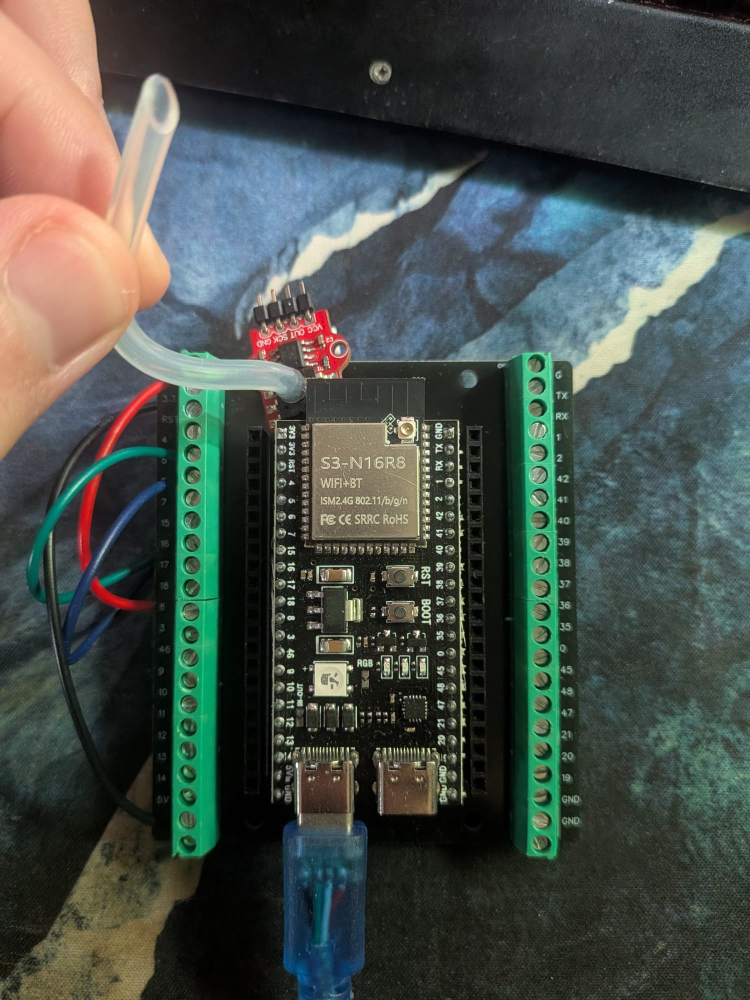
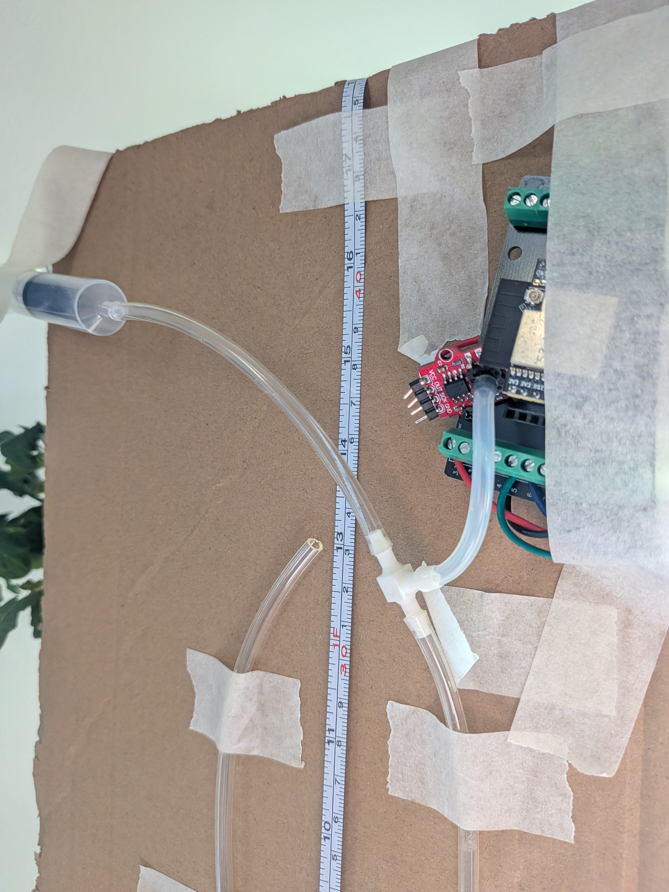

# Hardware and connections

The apparatus is documented by two supplied photographs and the experimenter's description. The photographs support component layout and visible labels; they do not verify electrical continuity, exact dimensions or material properties.

Figure H1. ESP32-S3 N16R8 board on a terminal carrier, red pressure module, USB connection and jumper leads. The module marking identifies the board variant; an exact pressure-transducer part number is not visible.

Figure H2. Mounted tubing, metric scale, syringe, T-fitting and pressure-module connection. The view documents the actual assembly but does not establish a metrologically qualified reference or a measured leak rate.

## Bill of materials

| ID | Component | Quantity | Evidence and limits |
| --- | --- | --- | --- |
| H01 | ESP32-S3 N16R8 development board | 1 | Experimenter identification and board photograph; exact board vendor not documented |
| H02 | HX710B-based pressure sensing module | 1 | Module photograph, HX710B firmware class and experimenter statement; transducer model and pressure rating not verified |
| H03 | USB cable and host power | 1 set | Photographed; supply quality not measured |
| H04 | Jumper leads and terminal carrier | 1 set | Photographed; continuity not independently retested |
| H05 | Transparent flexible tube | 1 | Approximately 90 cm before assembly, per experimenter; bore and material not documented |
| H06 | Water U-tube reference | 1 | Photographed and described; water properties and temperature not measured |
| H07 | Metric measuring scale | 1 | Photograph shows a flexible metric scale; no calibration certificate or uncertainty recorded |
| H08 | Mounting panel and tape | 1 | Approximately 50 by 25 cm per experimenter; not measured during this review |
| H09 | Manual 10 mL syringe | 1 | Experimenter statement and photograph; displacement is not a pressure standard |
| H10 | T-fitting and pneumatic connections | 1 set | Photographed; dimensions, leakage and pressure rating not documented |

## Electrical connection table

| Module connection | ESP32 connection | Function | Evidence |
| --- | --- | --- | --- |
| Sensor VCC | ESP32 3V3 | 3.3 V supply | Experimenter; red lead visible |
| Sensor GND | ESP32 GND | Common ground | Experimenter; black lead visible |
| Sensor OUT or DOUT | GPIO 5 | Digital ADC data | Sketch constant; green lead visible |
| Sensor SCK | GPIO 6 | Digital ADC clock | Sketch constant; blue lead visible |
| USB | Host computer or supply | Power, programming and serial | Photo; sketch Serial.begin(115200) |

Lead colors corroborate the experimenter description, but wiring must be checked by pin label when reproducing the assembly. The terminal carrier is not separately characterized. USB power is documented; regulator noise and rail voltage were not measured during this review.

## Pneumatic path and sign

The syringe, pressure-sensor port and one U-tube leg share a T-connected air space; the opposite leg is open to atmosphere. The source analysis defines signed height difference as `left_cm - right_cm`. For physical elevations measured upward, positive gauge pressure equals `rho*g*(z_open - z_connected)`. The left/right convention must therefore be checked against the actual port and scale orientation rather than inferred from a photograph alone. The empirical calibration retains the recorded convention.

The free opening supplies atmospheric pressure as the reference. Keep liquid from reaching the sensor. Only static or slowly changing pressures near the demonstrated interval are supported by these records.

## Information not documented

Pressure-transducer model, manufacturer, verified rated range, tubing internal diameter, tubing material, fitting specifications, water temperature, water composition, scale calibration, uncertainty of each height reading, leak rate, settling time and original firmware build settings are not established by the supplied files. The N16R8 designation is not evidence that the sketch allocates its sample buffer in PSRAM.
