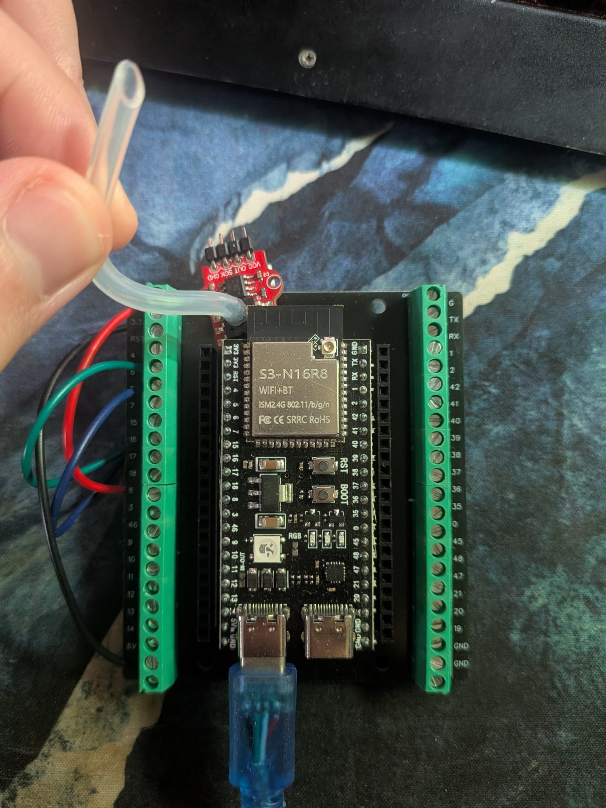
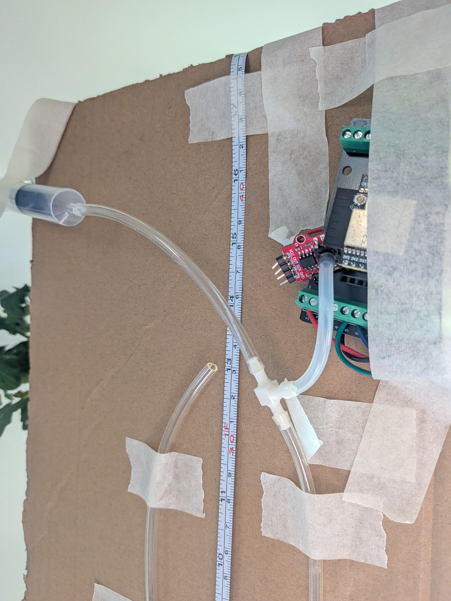
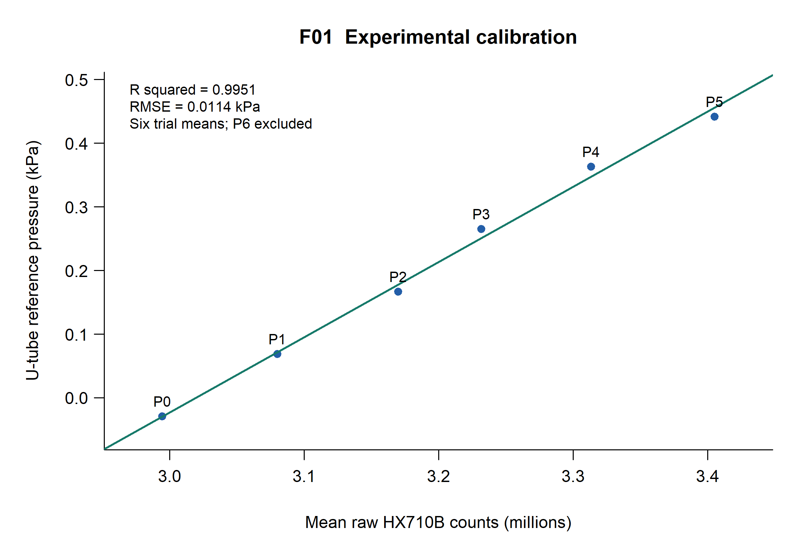
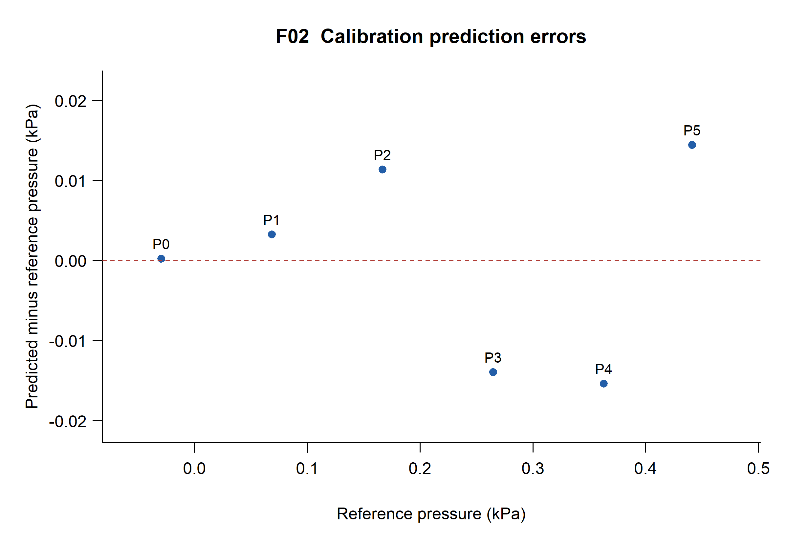
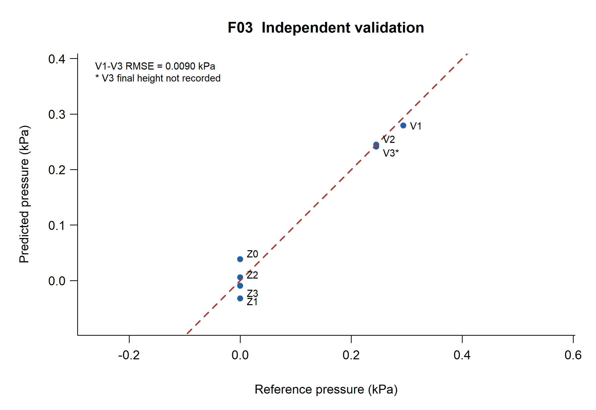
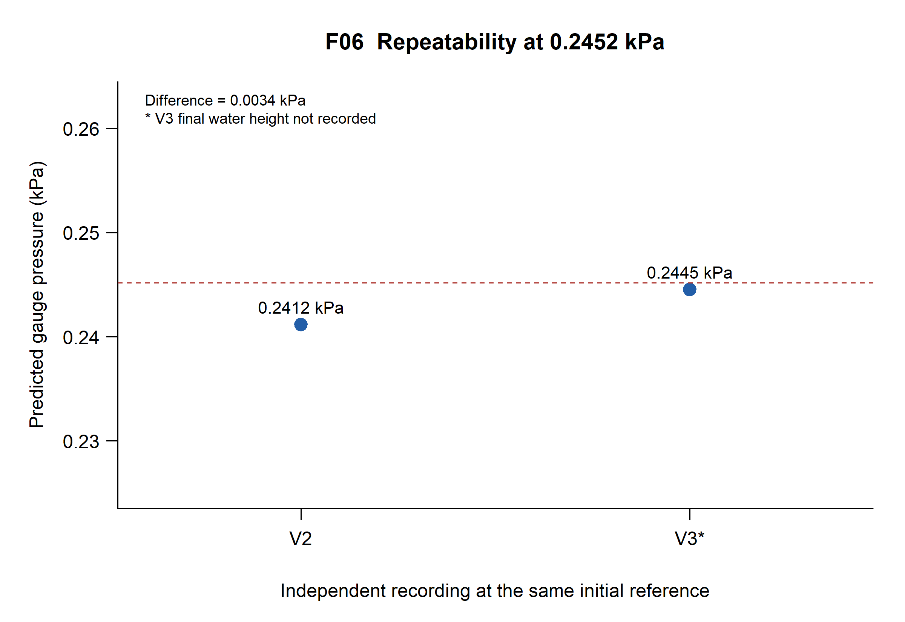
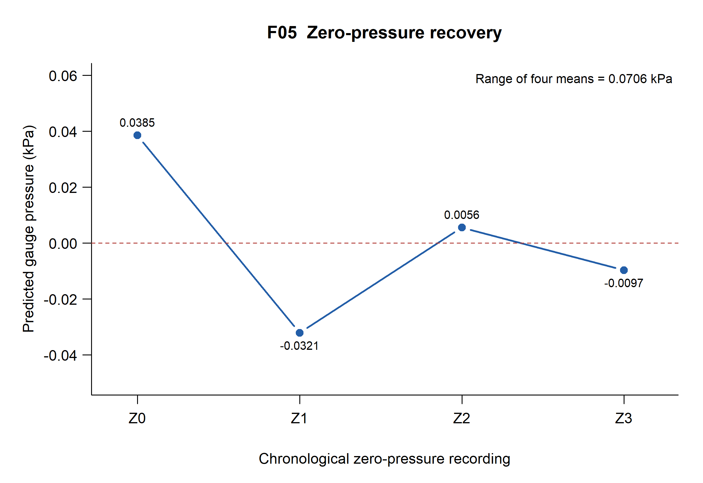
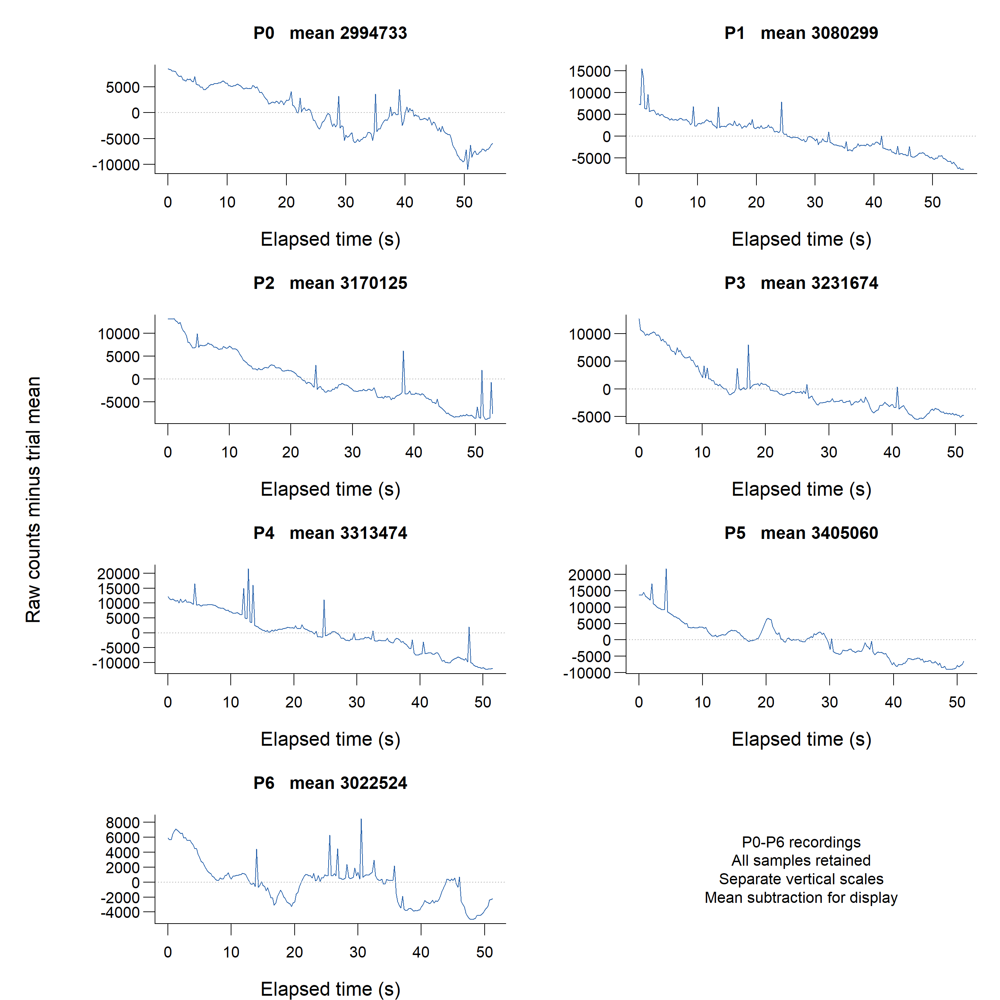
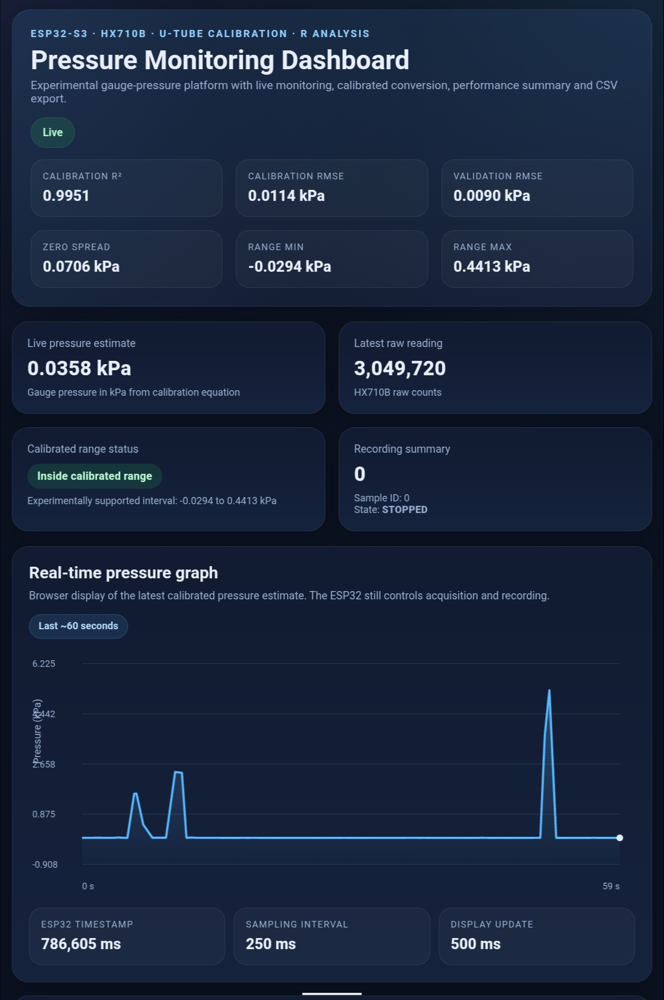

# Development and Experimental Calibration of an ESP32-Based Low-Pressure Monitoring System Using a U-Tube Manometer

Rafael Patrick Przydzimirski

ENGINEERING TECHNICAL REPORT

Educational experimental engineering prototype

Rafael Patrick Przydzimirski

9 November 2026

Documentation review edition 1.0

This report finalizes an already completed calibration experiment. Fourteen original recordings support a six-trial linear calibration and later validation. The analysis reproduces the reported fit and positive-pressure errors, while a larger observed zero-offset variation limits interpretation of measurement performance.

The platform is intended for engineering education, prototyping and analysis. It is not a clinical, patient-monitoring, safety-critical or certified instrument. No institutional review, supervisor approval or affiliation is claimed.

Publication status: prepared locally for owner review. No GitHub repository or release has been created.

<!-- PAGE BREAK -->

## Abstract

A low-pressure acquisition platform was developed using an ESP32-S3 N16R8 board and an HX710B-based pressure module. A manually pressurized water U-tube provided an approximate gauge-pressure reference, and a local Wi-Fi webpage supported live indication, recording and CSV export. The objective was to connect embedded instrumentation with physical calibration and reproducible statistical evaluation using the completed experimental record.

Fourteen original CSVs contain 2937 timestamped raw readings. An unweighted ordinary least-squares model fitted six P0-P5 trial means; P6 was excluded as an initial zero-return check. Recorded water-height differences span −0.3 to +4.5 cm, corresponding to −0.02941995 to +0.44129925 kPa under the experimental conversion. The recalculated model is P (kPa) = −3.56846908986 + 0.00000118183110197 times raw counts. Calibration R squared is 0.995101539 and trial-level fit RMSE is 0.01139345 kPa.

The unchanged model was applied to the later sequence Z0, V1, Z1, V2, Z2, V3, Z3. V1 used its measured 3.0 cm height difference. Positive-pressure validation RMSE across V1-V3 is 0.00897939 kPa; V3 lacks a final water-height measurement, so this result is conditional on its assigned reference. Excluding V3 gives 0.01098822 kPa for V1-V2. The four zero-pressure means span 0.07064438 kPa, and RMSE across all seven validation trials is 0.02029445 kPa. These results preserve the observed zero-offset variation rather than concealing it in the positive-pressure summary.

The project demonstrates a reproducible calibration workflow and functioning monitoring interface, as reported by the experimenter and supported by screenshots. Its limits include a nontraceable reference, time-dependent signals, sparse independent trials and unquantified uncertainty contributions. The supplied final firmware was sanitized and compiled, while historical data and original scientific figures were preserved. Statistical fit and validation errors are experimental indicators rather than certified accuracy specifications.

## Keywords

Biomedical instrumentation; ESP32-S3; HX710B; gauge pressure; U-tube manometer; experimental calibration; independent validation; zero-offset variation; reproducible R analysis.

### Evidence convention

Measured refers to saved sensor counts, timestamps and recorded height values. Calculated refers to pressures, model estimates and summary statistics derived from them. Assumed identifies physical approximations or an unverified reference condition. Source reviewed describes code behavior; reported operation identifies the experimenter confirmation. These evidence classes are kept distinct throughout.

<!-- PAGE BREAK -->

## Contents

The report is accompanied by a complete repository package containing raw data, reference metadata, base-R analysis, original and regenerated figures, sanitized firmware and detailed reproduction instructions. Appendix tables identify verified evidence and checks that still require physical hardware.

<!-- PAGE BREAK -->

## 1 Introduction

Digital pressure modules provide convenient counts, but those counts acquire engineering meaning only after their relationship to a physical reference is established. A working display is therefore one part of the measurement chain. Reference generation, timestamped acquisition, model construction and independent evaluation determine what the indicated pressure can support.

This project combines an ESP32-S3, an HX710B-based module and a homemade water U-tube. The assembly records raw counts and timing on the microcontroller, provides a local browser interface and exports data for analysis in R. Hydrostatic water-height differences supply an accessible approximate gauge-pressure reference. The work is framed as a completed educational engineering prototype, with its observed deficiencies retained as findings [1-4].

## 2 Engineering Problem and Motivation

The engineering problem was to turn an operating pressure-sensing module into an experimentally interpretable low-pressure platform. The solution needed to preserve original measurements, associate them with an approximate reference, document a conversion equation and show whether that equation transfers to later recordings. A linear fit alone could not establish reliable zero recovery or eliminate reference uncertainty.

For biomedical engineering education, the platform illustrates sensor integration, data acquisition and the distinction between an instrument indication and a defensible measurement result. It does not establish suitability for physiological pressure measurement. No patient, clinical or safety-critical experiment forms part of the supplied evidence.

## 3 Project Objectives

Document the actual electronic and pneumatic assembly, including verified wiring and specifications that remain unknown.

Reconstruct the original six-trial calibration, retain the P6 holdout and evaluate the later validation recordings without refitting.

Explain zero-offset variation, within-recording time dependence, limited repeatability evidence and the approximate reference.

Provide portable R analysis, unchanged raw data, six scientific figures, sanitized firmware and a complete technical record for review and reuse.

The scope is finalization of existing work. No additional experiments or major firmware changes are required to complete the documentation. Recommendations are separated from completed activities.

<!-- PAGE BREAK -->

## 4 System Requirements

The requirements below describe the implemented educational platform and the evidence needed to support its documentation. No numerical accuracy target was specified before the experiment, so the measured RMSE values are reported as outcomes rather than retrospective acceptance limits. The full requirements-and-verification matrix in Appendix B includes rationale, method, evidence and status for each item.

Table 1. Functional and quality requirements overview

Table 1. Functional and quality requirements overview

| Group | Required behavior | Evidence needed |
| --- | --- | --- |
| Acquisition | Read raw sensor output and associate it with trial-local IDs and MCU timestamps. | Saved CSV rows and acquisition source. |
| Recording | Retain raw data, bound memory use and export a scientific dataset. | Original exports, buffer structure and export handler. |
| Conversion | Apply the calibration equation and display the demonstrated interval. | Recomputed model, constants and interface evidence. |
| Monitoring | Display pressure and raw counts with a live time-series view. | Screenshots, experimenter confirmation and browser source. |
| Reproducibility | Rebuild the fit, validation, result tables and six figures from original files. | Fresh-session R execution and numerical checks. |
| Documentation | State assumptions, uncertainties, missing information and restrictions on interpretation. | Report, metadata and final review. |
| Publication | Exclude credentials and private configuration, retain source provenance and use explicit attribution. | Sanitization comparison, hash checks and review checklist. |

Historical CSVs verify raw acquisition and export for the data actually collected. Source review verifies that the final sketch implements a five-field sample structure and the required HTTP handlers. Experimenter confirmation and screenshots support operation of the webpage. The target build verifies compilation compatibility. These evidence types are not interchangeable: compilation does not verify sensor operation, and a screenshot does not measure latency or accuracy.

The completed requirements record therefore uses qualified status descriptions. Final-firmware CSV round trips, timeout handling, full-buffer behavior and operation under HTTP load remain unexecuted hardware checks. They are documented as limits of verification, not as missing experiments needed to finalize the statistical project.

<!-- PAGE BREAK -->

## 5 Hardware and Physical Architecture

The assembly includes the documented ESP32-S3 N16R8 development board, a pressure module accessed through the HX710B interface, USB power, jumper wiring and a terminal carrier. The exact transducer element and module manufacturer are not established by the source files. A nominal vendor pressure range is not assumed from the ADC model or the board appearance.

Table 2. Hardware bill of materials

Table 2. Hardware bill of materials

| ID | Component | Qty | Verified basis and remaining detail |
| --- | --- | --- | --- |
| H01 | ESP32-S3 N16R8 development board | 1 | Experimenter identification and board photograph; exact board vendor not documented |
| H02 | HX710B-based pressure sensing module | 1 | Module photograph, HX710B firmware class and experimenter statement; transducer model and pressure rating not verified |
| H03 | USB cable and host power | 1 set | Photographed; supply quality not measured |
| H04 | Jumper leads and terminal carrier | 1 set | Photographed; continuity not independently retested |
| H05 | Transparent flexible tube | 1 | Approximately 90 cm before assembly, per experimenter; bore and material not documented |
| H06 | Water U-tube reference | 1 | Photographed and described; water properties and temperature not measured |
| H07 | Metric measuring scale | 1 | Photograph shows a flexible metric scale; no calibration certificate or uncertainty recorded |
| H08 | Mounting panel and tape | 1 | Approximately 50 by 25 cm per experimenter; not measured during this review |
| H09 | Manual 10 mL syringe | 1 | Experimenter statement and photograph; displacement is not a pressure standard |
| H10 | T-fitting and pneumatic connections | 1 set | Photographed; dimensions, leakage and pressure rating not documented |

Approximate tubing length, panel dimensions and syringe volume are experimenter-provided information rather than measurements made during this review. The photograph shows a flexible metric scale, although the experimenter describes the reference generally as a metric ruler. No scale calibration or uncertainty certificate is available. The physical arrangement is documented photographically in Section 9.

The N16R8 designation and the corresponding Espressif module family provide hardware context [9]. The public build uses 16 MB flash and OPI PSRAM options, but the sketch has no explicit PSRAM allocation for its sample array. Build settings do not establish the exact board manufacturer or the settings used in the earlier acquisition session.

<!-- PAGE BREAK -->

## 6 Working Principles

The measurand is gauge pressure relative to local atmosphere. An open-leg manometer compares the pressure at the connected gas space with atmospheric pressure through the equilibrium of the liquid columns. At a common depth in the same stationary liquid, pressures are equal; the difference in the vertical column elevations therefore corresponds to a pressure difference [4].

$$\Delta P=\rho g\Delta h \tag{1}$$

$$P_g=P_{abs}-P_{atm} \tag{2}$$

Here rho is water density, g is gravitational acceleration and delta h is the signed vertical difference, not the tube length or the distance along a curved leg. Absolute pressure includes atmospheric pressure; gauge pressure is zero when the connected space is at the same pressure as the open leg. Positive gauge pressure corresponds to compression above atmosphere, and negative gauge pressure to pressure below it.

$$P_{ref}(\mathrm{kPa})=0.0980665[h_L(\mathrm{cm})-h_R(\mathrm{cm})] \tag{3}$$

Equation 3 is the convention used by the original R scripts and is retained exactly. The factor follows from the assumptions rho = 1000 kg/m³, standard gravity 9.80665 m/s² and centimetre-to-metre and pascal-to-kilopascal conversions. Water temperature, local gravity and air-column corrections were not measured or applied. The U-tube is an approximate experimental reference with no demonstrated traceability to a calibrated pressure standard.

For upward physical elevations, the connected gauge pressure is rho g times the open-leg elevation minus the connected-leg elevation. Applying the source labels therefore requires checking which side is atmospheric and whether the scale coordinates increase upward. The photographs alone do not fully establish that mapping. The calibration uses the recorded left-minus-right convention without silently changing its sign.

The syringe generates a volume displacement rather than a known pressure. Resulting pressure depends on trapped-air volume, temperature, tubing and syringe compliance, leaks and liquid displacement. Its millilitre graduations cannot substitute for the measured water-height difference. The hydrostatic equation also assumes static water, a connected gas space and negligible unaccounted head or capillary offsets.

<!-- PAGE BREAK -->

## 7 Electrical and Pneumatic Connections

Table 3. Electrical connections

Table 3. Electrical connections

| Module connection | ESP32 connection | Purpose | Evidence |
| --- | --- | --- | --- |
| Sensor VCC | ESP32 3V3 | 3.3 V supply | Experimenter; red lead visible |
| Sensor GND | ESP32 GND | Common ground | Experimenter; black lead visible |
| Sensor OUT or DOUT | GPIO 5 | Digital ADC data | Sketch constant; green lead visible |
| Sensor SCK | GPIO 6 | Digital ADC clock | Sketch constant; blue lead visible |
| USB | Host computer or supply | Power, programming and serial | Photo; sketch Serial.begin(115200) |

Pin constants in the final sketch identify GPIO 5 as data and GPIO 6 as clock. Sensor supply at 3.3 V and the common ground are stated by the experimenter and corroborated by the photographed leads. Lead color is a visual aid; a reproduction should follow electrical pin labels. No continuity, logic-voltage or power-integrity measurement was rerun during documentation.

Table 4. Pneumatic connection path

Table 4. Pneumatic connection path

| Connection | Purpose | Documentation limit |
| --- | --- | --- |
| Syringe to T-fitting | Manually change the connected air-space pressure. | Displacement and seal quality were not calibrated. |
| T-fitting to sensor port | Apply the generated gauge pressure to the sensing module. | Transducer internals, isolation and rated range are unknown. |
| T-fitting to connected manometer leg | Expose water column to the same nominal gas pressure. | Leak rate and any tubing compliance were not quantified. |
| Opposite manometer leg to atmosphere | Establish the atmospheric boundary condition. | No absolute-pressure or environmental record is supplied. |

The intended pneumatic topology is one shared pressure node between syringe, sensor and a single manometer leg, with the other leg vented. It is supported by the experimenter description and the visible T-fitting and tube connections. No dimensions or flow restrictions are inferred beyond the supplied evidence. Liquid entry into the sensor would change or damage the measurement system; keeping the pressure port dry is an operating instruction rather than a verified protection feature.

The reference uses the full difference between the two water levels. A motion of one leg alone is not automatically the total head difference, especially when tube bores or displaced volumes are not known. The source metadata already give two heights per trial, which are used directly.

<!-- PAGE BREAK -->

## 8 Embedded Software Architecture

The final application separates raw acquisition, linear conversion, memory recording, HTTP communication, browser visualization and offline R analysis. The public sketch is the supplied final version with only its credential declarations replaced by an include of private configuration. This preserves the experimental software rather than introducing an untested redesign [3,8,10].

Table 5. Responsibilities in the software chain

Table 5. Responsibilities in the software chain

| Layer | Implemented behavior | Evidence and limits |
| --- | --- | --- |
| Sensor acquisition | request, readiness polling and fetch(true) on the ESP32. | Source; historical counts support acquisition, but earlier sketch not supplied. |
| Calibration | Intercept plus slope times raw count; estimated-range comparison. | Coefficients reproduced in R; rounded firmware constants retained. |
| Recording | Static sample array with trial ID, two timestamps, raw count and pressure. | Source; final five-column export not exercised on hardware. |
| HTTP | Synchronous local WebServer on port 80. | Five route handlers; no authentication or TLS. |
| Browser | 500 ms polling, current values, controls and canvas history. | Source and screenshots; operation confirmed by experimenter. |
| Scientific analysis | Offline import, trial means, OLS calibration and frozen-model validation. | Base R rerun from a clean session. |

The main loop services an HTTP client, calls the acquisition state machine and delays for 1 ms. When due, acquisition requests a conversion and returns while waiting for readiness. If readiness is absent for more than 300 ms, it abandons the attempt and schedules a new one. On readiness it reads the count, timestamps completion, updates live values and schedules the next request 250 ms after that read.

This is nonblocking waiting for the sensor, while fetch itself is synchronous. Startup Wi-Fi connection waits in a blocking loop, and HTTP handling and CSV streaming are also synchronous. The architecture therefore does not guarantee hard real-time timing or uninterrupted acquisition under every network condition. Historical timing is evaluated from the CSV timestamps rather than inferred from a display label.

Acquisition continues when recording is stopped. Recording IDs advance only for stored samples, while the latest live timestamp continues to change. A browser may display a current sensor reading with an unchanged sample ID; this is expected behavior under the implemented division between live indication and trial storage.

<!-- PAGE BREAK -->

### HTTP communication and recording memory

Table 6. HTTP endpoint specification

Table 6. HTTP endpoint specification

| Route | Response | Implemented behavior | User consequence |
| --- | --- | --- | --- |
| / | HTML | Serves embedded dashboard | Read only |
| /latest | JSON | raw_pressure, pressure_kPa, esp32_ms, recording, sample_count, sample_id, in_range | Read only |
| /start | Plain text | Clears buffer, resets ID, timestamps start, enables recording | Erases previous RAM recording |
| /stop | Plain text | Disables recording, retains buffered samples | Preserves buffer until next start or reset |
| /csv | CSV attachment | Streams all current buffered rows as pressure_trial.csv | Stop first; streaming occupies the request handler |

The browser uses GET requests. Route registrations do not explicitly restrict a handler to that method. A trusted local network is appropriate because the control routes have no authentication. The webpage is embedded in the sketch and does not require an external chart library or cloud service.

Each Sample contains three unsigned 32-bit integer fields, one signed 32-bit raw count and one 32-bit float. The 5000-entry static array therefore represents approximately 100000 bytes on the compiled target. The complete build reports 147068 bytes of global-variable memory; that total includes other state. No explicit PSRAM allocation is used, and actual heap margin during HTTP operation was not measured.

At approximately 4 stored samples per second, capacity corresponds to roughly 1250 s or 20.8 min. This is a calculated estimate, not a measured endurance run. A new /start call clears the current buffer. Reset or power loss also loses the data. The code stops recording when a subsequent sample finds the buffer full. Stop before downloading to avoid interleaving acquisition with a synchronous export.

The browser retains at most 180 distinct sensor timestamps within a 60000 ms age window. Its roughly 2 Hz polling can omit readings that are present in the roughly 4 Hz MCU recording. The graph is an observation tool rather than the complete scientific time series. Staleness is inferred in the browser from a timestamp not changing for about 3 s.

The final sketch exports five columns, including derived pressure. Every supplied raw file has four columns, without pressure. The exact earlier acquisition sketch is unavailable, so final-code behavior is not retrospectively assigned to every historical recording. The complete sanitized final sketch passed compilation with placeholder configuration; no hardware upload occurred.

<!-- PAGE BREAK -->

## 9 Experimental Apparatus

Figure 1. Actual electronics and pneumatic apparatus. Left: ESP32-S3 N16R8 board, terminal carrier, HX710B-based module and USB connection. Right: mounted transparent tube, metric scale, syringe, T-fitting and sensor connection. Photographs support the documented arrangement; they do not verify dimensions, continuity, leak rate or pressure-standard traceability. Publication derivatives have embedded metadata removed.

The apparatus photographs document the practical assembly rather than an idealized drawing. The board and pressure module are physically supported on the mounted arrangement; tubing and the T-fitting connect the syringe, manometer and sensor. The stated approximately 90 cm preassembly tubing length and 50 by 25 cm panel dimensions are experimenter estimates. Tubing bore, liquid temperature and exact transducer identity remain undocumented.

A separate tablet photograph and a supplementary video were inventoried. The tablet photograph includes a browser identity, a private local address and reflections; the dashboard screenshots provide interface evidence without those details. The video is not required for reproducing the data analysis and was withheld from the publication package pending audiovisual privacy review.

<!-- PAGE BREAK -->

## 10 Experimental Procedures

The procedure below reconstructs the completed sequence from the supplied R scripts, CSVs, photographs and experimenter statements. It does not claim a specific stabilization period, leak test or environmental control that was not recorded. The software assigns one reference pressure to each full recording [1,2].

### Calibration sequence

1. The ESP32 and pressure module were connected with the documented pins and supply. A local Wi-Fi webpage supported acquisition and export, and a water-filled U-tube supplied a visible reference.

2. Pressure was changed manually using the syringe. Left and right water-height values were recorded and converted using Equation 3. Intended targets and syringe positions were not used as pressure measurements.

3. Recordings P0-P5 supplied six increasing assigned pressure settings. P0 used a signed height difference of −0.3 cm and is therefore slightly negative rather than zero.

4. P6 was recorded with equal water levels as an initial zero-return check and excluded from the regression. Its prediction was retained as a separate result.

### Independent validation sequence

After calibration, new recordings were obtained in the order Z0, V1, Z1, V2, Z2, V3, Z3. Z0-Z3 are four further equal-height zero-pressure records. V1 used a measured 3.0 cm difference, equal to 0.2941995 kPa. V2 and V3 used approximately 2.5 cm, assigned as 0.24516625 kPa in the original analysis. The experimenter explicitly reports that the final height for V3 was not recorded.

The original model was applied without fitting another regression to the validation data. V3 retains its documented initial/reference value to preserve the completed analysis. An additional V1-V2-only RMSE shows the sensitivity to excluding that trial; no final height is invented from the sensor response.

### Timing and procedural record

Within-phase boot timestamps support the listed acquisition order. Validation timestamps restart below the calibration sequence, consistent with a different boot session or clock reset. They do not give a wall-clock interval between phases. Acquisition date/time, exact settling periods, temperature, leak rate and separately logged final heights for the other trials cannot be recovered from the CSVs.

For a future reproduction, the operator should document initial and final menisci, align the scale vertically, read at eye level after visible motion subsides and retain distinct raw filenames. These are proposed controls for repeating the method, not claims that every control was verified in the completed experiment.

<!-- PAGE BREAK -->

## 11 Data Acquisition Methodology

All original CSV rows were retained. There was no transient deletion, smoothing, detrending or outlier removal. The analysis computes one mean raw count and one sample standard deviation per recording. It then joins those summaries to manually recorded manometer metadata, which were stored in the R scripts rather than the CSVs.

Table 7. Recovered trial metadata and sample counts

Table 7. Recovered trial metadata and sample counts

| Trial | Left cm | Right cm | Reference kPa | Rows | Role |
| --- | --- | --- | --- | --- | --- |
| P0 | 14.5 | 14.8 | -0.02941995 | 220 | Fit |
| P1 | 15 | 14.3 | 0.06864655 | 222 | Fit |
| P2 | 15.5 | 13.8 | 0.16671305 | 212 | Fit |
| P3 | 16 | 13.3 | 0.26477955 | 206 | Fit |
| P4 | 16.5 | 12.8 | 0.36284605 | 207 | Fit |
| P5 | 17 | 12.5 | 0.44129925 | 205 | Fit |
| P6 | 14.5 | 14.5 | 0.00000000 | 206 | P6 holdout |
| Z0 | 14.5 | 14.5 | 0.00000000 | 205 | Validation zero |
| V1 | 16 | 13 | 0.29419950 | 205 | Validation positive |
| Z1 | 14.5 | 14.5 | 0.00000000 | 216 | Validation zero |
| V2 | 15.75 | 13.25 | 0.24516625 | 203 | Validation positive |
| Z2 | 14.5 | 14.5 | 0.00000000 | 220 | Validation zero |
| V3 | 15.75 | 13.25 | 0.24516625 | 203 | Validation positive |
| Z3 | 14.5 | 14.5 | 0.00000000 | 207 | Validation zero |

Each recording contains 203-222 samples, with a first-to-last span of 50.532-55.309 s. Across all files there are 2937 readings. Every trial has a median interval of 250 ms; observed intervals range from 250 to 256 ms and effective rates are approximately 3.996-3.997 Hz. All required fields are finite numeric values, IDs advance by one and timestamps increase. The difference between boot time and experiment-relative time is constant within each file.

These checks establish consistency of saved rows. They do not prove that every internal sensor conversion was recorded, that the MCU clock is calibrated, or that no physical transient occurred between rows. The final firmware timestamp is captured after fetch completion; the exact historical acquisition firmware was not supplied. The first sample occurs after Start and need not have experiment_ms equal to zero.

<!-- PAGE BREAK -->

## 12 Statistical Calibration Methodology

The regression uses one raw-count mean for each physical calibration trial. Repeated readings within a trial share the same assigned pressure, environment and time-dependent signal. Treating them as separate calibration experiments would inflate the apparent sample size and allow longer recordings to dominate. The original method instead gives each P0-P5 setting equal weight [2,7].

$$\bar{x}_i=\frac{1}{n_i}\sum_{j=1}^{n_i}raw_{ij} \tag{4}$$

$$\widehat{P}_i=a+b\bar{x}_i \tag{5}$$

Here n_i is the count of saved samples in a trial, x-bar_i is its mean raw count and the response is the assigned U-tube pressure. Ordinary least squares estimates an intercept a and slope b from six means. P6 and every validation trial are excluded. All later pressures are predicted using these same coefficients; validation is independent by acquisition sequence, not by a separate laboratory or instrument.

$$RMSE=\sqrt{\frac{1}{m}\sum_{i=1}^{m}(\widehat{P}_i-P_{ref,i})^2} \tag{6}$$

$$R^2=1-\frac{SSE}{SST} \tag{7}$$

Error is predicted minus reference pressure. RMSE is computed across the named trial means with denominator m: six for calibration, three for positive validation and seven for all validation. The residual standard error instead uses six minus two residual degrees of freedom. SSE is the calibration sum of squared fit errors and SST is the sum of squared deviations of the reference pressures from their calibration mean.

R squared evaluates this fitted relationship within the training settings. It is not a percentage accuracy. Within-recording SD describes dispersion including slow signal changes; it is not the standard uncertainty of the mean. Serial correlation and pressure-time confounding prevent a simple square-root-of-sample-count interpretation. OLS also does not explicitly model uncertainty in either raw-count means or the manometer reference.

<!-- PAGE BREAK -->

## 13 Calibration Results

$$\widehat{P}(\mathrm{kPa})=-3.56846908986+1.18183110197\times10^{-6}\,raw \tag{8}$$

The recalculated coefficients agree with the previous values at their stated precision. R squared is 0.995101539, calibration RMSE is 0.01139345 kPa and residual standard error is 0.01395406 kPa with four residual degrees of freedom. Digits are retained for numerical reproduction, not as evidence of physical resolution or reference precision.

Figure 2. Calibration of the six P0-P5 trial means against the assigned U-tube reference pressures. The line is the unweighted ordinary least-squares fit; P6 and all validation trials are excluded. R squared is 0.995101539 and RMSE is 0.01139345 kPa. Counts are displayed in millions. The line is an empirical calibration over the tested interval and does not establish a certified accuracy specification.

The reference interval is −0.02941995 to +0.44129925 kPa. It describes the experimental settings, not the rated sensor span. The intercept is the fitted pressure at zero counts and is extrapolated far from the observed count region; it is not a direct measurement of zero-offset error near three million counts.

<!-- PAGE BREAK -->

### Calibration prediction errors

Table 8. Trial-mean calibration predictions and errors

Table 8. Trial-mean calibration predictions and errors

| Trial | Mean raw counts | Reference kPa | Predicted kPa | Error kPa |
| --- | --- | --- | --- | --- |
| P0 | 2994732.673 | -0.02941995 | -0.02920088 | +0.00021907 |
| P1 | 3080298.523 | 0.06864655 | 0.07192351 | +0.00327696 |
| P2 | 3170125.226 | 0.16671305 | 0.17808350 | +0.01137045 |
| P3 | 3231674.131 | 0.26477955 | 0.25082391 | -0.01395564 |
| P4 | 3313473.899 | 0.36284605 | 0.34749742 | -0.01534863 |
| P5 | 3405060.268 | 0.44129925 | 0.45573704 | +0.01443779 |

Figure 3. Calibration prediction error, defined as fitted pressure minus U-tube reference pressure, for P0-P5. The dashed line denotes zero error. These are in-sample errors for six physical settings; their signs and magnitudes are retained without trimming or correction. The plot cannot distinguish reference error, time effects and sensor nonlinearity.

The errors range from −0.01534863 to +0.01443779 kPa. The small training residuals coexist with within-recording time dependence and between-trial zero variation. The data do not separate sensor nonlinearity from errors in the reference or changes associated with the monotonic pressure sequence.

<!-- PAGE BREAK -->

## 14 Independent Validation Results

Table 9. Frozen-model independent validation in acquisition order

Table 9. Frozen-model independent validation in acquisition order

| Trial | Reference kPa | Predicted kPa | Error kPa |
| --- | --- | --- | --- |
| Z0 | 0.00000000 | 0.03853627 | +0.03853627 |
| V1 | 0.29419950 | 0.27918225 | -0.01501725 |
| Z1 | 0.00000000 | -0.03210811 | -0.03210811 |
| V2 | 0.24516625 | 0.24117071 | -0.00399554 |
| Z2 | 0.00000000 | 0.00557929 | +0.00557929 |
| V3* | 0.24516625 | 0.24452875 | -0.00063750 |
| Z3 | 0.00000000 | -0.00969853 | -0.00969853 |

Positive-pressure RMSE is 0.00897939 kPa for V1-V3. Excluding V3, marked with an asterisk because its final height is missing, gives 0.01098822 kPa for V1-V2. The positive-pressure mean signed error is −0.00655010 kPa. All-validation RMSE including zero trials is 0.02029445 kPa. No coefficient was adjusted after these results were observed.

Figure 4. Independent validation using the original frozen P0-P5 model. The dashed line indicates equality of predicted and reference pressure. The positive-pressure RMSE of 0.00897939 kPa uses V1-V3 only; Z0-Z3 are displayed but excluded from that number. V1 uses the actual 3.0 cm difference. V3 uses its recorded 2.5 cm reference and lacks a final height measurement.

The three positive trials occupy only two nearby assigned reference pressures. Their RMSE therefore characterizes this limited validation set and does not verify uniform performance over the full calibration interval. Its value below the fit RMSE does not establish improved accuracy.

<!-- PAGE BREAK -->

## 15 Repeatability and Drift Analysis

V2 and V3 were obtained at the same assigned initial/reference pressure of 0.24516625 kPa, with Z2 between them. Their predicted means are 0.24117071 and 0.24452875 kPa. The absolute difference is 0.00335804 kPa and the sample SD of the two means is 0.00237449 kPa.

Figure 5. Comparison of V2 and V3 trial-mean predictions at the same assigned initial reference of 0.24516625 kPa, shown by the dashed line. Their absolute difference is 0.00335804 kPa and the sample standard deviation of the two means is 0.00237449 kPa. V3 lacks a final water-height measurement; two trials provide limited, conditional repeatability evidence.

This result demonstrates agreement between two trial means under nominally similar conditions. It is not a repeatability specification across pressures, days, devices or operators. V3 lacks an end-height measurement, and the within-trial signals themselves change with time. The distinction between a small difference of two averages and stable instantaneous pressure is essential.

P6, the initial recovery check excluded from calibration, predicts +0.00364341 kPa at an assigned zero reference. The later zeros are assessed separately on the following page; P6 is not added to the four-zero spread or used to tune the regression.

<!-- PAGE BREAK -->

### Zero pressure recovery

Figure 6. Chronological zero-pressure predictions for Z0, Z1, Z2 and Z3, interleaved with the positive validation trials in the original acquisition sequence. The dashed line denotes the assigned 0 kPa gauge reference. The range of the four means is 0.07064438 kPa. Connecting segments indicate order rather than continuous measurements or a fitted drift model.

Table 10. Zero-pressure validation summary

Table 10. Zero-pressure validation summary

| Statistic | Calculated value | Interpretation |
| --- | --- | --- |
| Maximum mean prediction | +0.03853627 kPa | Z0 |
| Minimum mean prediction | -0.03210811 kPa | Z1 |
| Range of four means | 0.07064438 kPa | Observed between-trial variation |
| Mean signed zero error | +0.00057723 kPa | Positive and negative offsets cancel |
| Zero-only RMSE | 0.02569613 kPa | Four zero trial means |

The mean signed zero discrepancy is small because the deviations change sign. It therefore conceals a much larger spread when read alone. This zero behavior is a principal limitation of the completed system. There is no continuous inter-trial zero trace, so connecting points by time order does not establish a drift rate or physical drift mechanism.

<!-- PAGE BREAK -->

### Within recording raw signal behavior

Figure 7. Raw signal behavior in the seven calibration-phase recordings P0-P6. Time is relative to each recording's first ESP32 timestamp. For legibility, each panel displays raw counts minus that trial's mean, with the mean printed in the panel title; separate vertical scales are used. No samples are removed, smoothed or detrended. The original absolute-count version is preserved. Falling signals indicate time dependence but do not identify its physical cause.

All seven calibration-phase descriptive linear trends are negative. Converted slopes range from approximately −0.000153 to −0.000522 kPa/s. These trends are retained rather than removed from the trial means. The records cannot determine whether pressure relaxation, leaks, temperature response or another process caused them.

<!-- PAGE BREAK -->

## 16 Measurement Uncertainty and Limitations

The reported errors are discrepancies relative to an approximate homemade reference. A complete uncertainty budget cannot be assigned because the record lacks quantified height-reading uncertainty, water temperature, tube geometry, leak rate and reference traceability. The report follows the distinction between measurement error and uncertainty described in the JCGM guidance [5,6].

Table 11. Uncertainty contributors and evidence status

Table 11. Uncertainty contributors and evidence status

| Contribution | Effect on result | Evidence available |
| --- | --- | --- |
| Height reading | Meniscus selection, parallax and scale alignment change assigned head. | Two recorded heights per trial; no evaluated uncertainty. |
| Hydrostatic conversion | Density, temperature, gravity and neglected air head affect the conversion. | Fixed factor retained; no environmental corrections. |
| Capillarity | Unequal bores or wetting can introduce differential level shifts. | Tube dimensions and contact angles unknown. |
| Pneumatics | Leaks, compliance and water motion can change actual pressure during a run. | Time-dependent counts observed; no isolated leak or motion record. |
| Sensor and electronics | Thermal response, offset change and supply noise may affect counts. | Raw sequences available; causes not independently measured. |
| Model and trial design | Sparse settings, correlated readings and pressure-time ordering limit inference. | Six fit trials; three positive validation trials; four zeros. |
| Reference stability | A single assigned pressure may not describe a changing trial. | V3 final height explicitly absent; other endpoints not separately logged. |

A 1 mm error in the total height difference changes the reference by 0.00980665 kPa. If each height were assigned an independent 1 mm standard uncertainty, the height contribution alone would be about 0.01387 kPa. This is an illustrative sensitivity calculation, not a measured property or an assigned uncertainty of this apparatus.

$$u_{height}=0.0980665\sqrt{u_L^2+u_R^2-2\operatorname{cov}(h_L,h_R)} \tag{9}$$

Equation 9 uses centimetre-based height inputs and applies only to their contribution to pressure uncertainty. It omits density, gravity, model and time-dependent effects. Common height-reading errors may be correlated; their covariance should not be assumed zero without justification. No expanded uncertainty or coverage probability is claimed.

<!-- PAGE BREAK -->

### Interpretation of performance and operating limits

Calibration fit measures agreement at the training settings. Independent validation evaluates later recordings with the frozen model. Precision describes dispersion under stated conditions, while repeatability refers to repeated measurements under similar conditions. Bias is a mean signed discrepancy for a specified set. Here these are operational descriptions of a small experiment, not universal device properties [6].

Zero-offset variation is directly observed between the equal-height trials. Time dependence is also present within recordings, but calling it thermal drift would require temperature evidence. Systematic effects can include a reference scale or sign error; random effects can include fluctuating indications and variable readings of a meniscus. The available design does not independently estimate all such components.

The narrow calibration interval provides little evidence for large negative pressure or higher positive pressure. Values outside −0.02941995 to +0.44129925 kPa are extrapolations. The regression may indicate a strong linear relationship while still retaining nonlinearity, hysteresis or changing offsets. Six unreplicated settings cannot support a strong formal lack-of-fit or hysteresis assessment.

Sequential samples share a pressure assignment and slow trends; they are not independent realizations of the complete experiment. Dividing the raw SD by the square root of the number of recorded samples would not account for serial dependence, reference error or changing pressure. The observed lag-one correlations are descriptive and include trend contributions. They are not an independently validated stochastic noise model.

The approximate reference, clustered positive validation pressures and small number of repeated trials limit generalization. Another module, wiring arrangement, pneumatic assembly or environment may produce a different calibration. A digital 24-bit ADC output does not establish usable pressure resolution or effective accuracy. The exact pressure-transducer identity and verified nominal range remain unknown.

No clinical, patient-monitoring, safety-critical or certified use is supported. The lack of a complete uncertainty budget and the observed zero variation are retained as valid findings. They do not prevent presenting the work as a completed educational instrumentation project.

<!-- PAGE BREAK -->

## 17 Real Time Monitoring Implementation

Figure 8. Supplied dashboard screenshot showing live pressure, raw counts, calibration summary, interval status and a recent pressure graph. The screenshot and experimenter confirmation document the interface, not synchronized reference measurements. Historical graph spikes extend outside the calibrated interval and are not used as calibration or validation evidence. Embedded metadata have been removed.

The interface updates estimated gauge pressure, raw counts, the current boot timestamp, recording status, sample count and calibration-range indication. Start, Stop and Download controls are present in the source and in a second supplied screenshot retained in the repository. A local canvas plot uses the latest received timestamps rather than an external service.

The numerical performance cards are static summaries from the original R analysis and remain unchanged. Their displayed 0.0090 kPa validation RMSE is the positive-pressure subset result; this report supplies the V3 caveat and broader zero-inclusive statistics. No webpage redesign was needed to finish documentation. Browser latency, endpoint behavior and final export formatting were not independently exercised on live hardware.

<!-- PAGE BREAK -->

## 18 Engineering Discussion

The project connects a physical reference with embedded recording and an offline analysis that can be inspected and reproduced. Original raw counts and timestamps remain available alongside metadata and derived results. Holding P6 outside the fit and retaining new validation trials strengthens the separation between model construction and performance assessment.

The principal interpretive issue is the difference between good calibration fit and stable measurement behavior. R squared is high because counts track the assigned pressure settings across the interval. It does not constrain every zero return. Positive validation RMSE is small for three nearby pressure trials, while the four equal-height records show appreciably larger variation. A single headline RMSE would leave out that behavior.

The calibration design also couples increasing reference pressure with acquisition order. Counts decrease within all calibration-phase records, so the recorded mean may depend on when a trial starts and how long it lasts. No samples were removed to improve agreement. A later design could control or record settling and temperature, but the present record does not justify attributing the changes to one physical mechanism.

V2-V3 agreement is informative at the level actually observed: two mean predictions are close at a common assigned initial head. It cannot establish repeatability over the full span, and V3 lacks a final reference reading. Reporting the original three-positive RMSE together with the two-positive sensitivity result preserves the completed analysis while making the reference limitation visible.

The final firmware provides a useful integration layer: it retains raw values, computes a pressure estimate, distinguishes recording from live display and exports scientific data. Nevertheless, its range flag operates on the predicted pressure rather than the physical reference. The P5 mean predicts approximately 0.4557 kPa, above the reference endpoint of 0.4413 kPa, so even a mean obtained during calibration can be flagged out of range. This follows from regression residuals and the implemented threshold definition; it is not a new measured fault.

Reproducibility improved through repository-relative paths, explicit metadata, fresh-session figure generation, numerical parity checks and preservation of source hashes. These changes support review without adding measurements or altering the calibration. Successful compilation supports build compatibility but leaves hardware-dependent behavior qualified. The complete package is technically reviewable as a finished educational experiment, with explicit limits on accuracy and scope.

<!-- PAGE BREAK -->

## 19 Conclusions

1. The completed ESP32-S3/HX710B platform acquired timestamped raw pressure-module counts and supported local browser monitoring and CSV recording, as evidenced by supplied data, source, screenshots and experimenter confirmation.

2. Six P0-P5 means reproduce a linear calibration over −0.02941995 to +0.44129925 kPa. The intercept is −3.56846908986 kPa, slope is 1.18183110197e-6 kPa/count, R squared is 0.995101539 and fit RMSE is 0.01139345 kPa. P6 remains a separate initial zero check.

3. Frozen-model positive validation gives 0.00897939 kPa RMSE for V1-V3, conditional on V3's retained reference despite its missing final height. Excluding V3 gives 0.01098822 kPa for V1-V2. All-validation RMSE is 0.02029445 kPa.

4. The 0.07064438 kPa range of four zero means and the time-dependent raw signals are material limitations. The experiment establishes neither a complete measurement uncertainty nor a certified accuracy specification.

5. The original data, original figures, portable analysis, sanitized final firmware and documentation are packaged for owner review. No new experiments, public repository or release are claimed.

## 20 Recommendations for Future Development

Future work should first strengthen measurement evidence rather than add system complexity. Record both initial and final meniscus heights and environmental conditions, evaluate the scale and reference uncertainty, and distinguish sensor offset change from actual pneumatic pressure relaxation. Randomized or replicated pressure settings and checks on increasing and decreasing pressure would better separate time effects and hysteresis.

A later instrument iteration could compare against a traceable pressure reference, evaluate multiple days and hardware units, and measure dynamic response, zero stability and performance under HTTP load. Firmware testing could exercise timeout, disconnect, full-buffer and export behavior. Persistent storage or temperature compensation should follow a demonstrated need and their own verification. These recommendations are optional extensions; the existing project is complete within its documented scope.

<!-- PAGE BREAK -->

## 21 References

[1] Przydzimirski, R. P. Original pressure-experiment record. Fourteen CSVs P0-P6 and Z0,V1,Z1,V2,Z2,V3,Z3, with supplied apparatus and dashboard images. Retained source hashes are listed in data/metadata/source_inventory.csv. Calendar acquisition timestamps are not present in the CSVs.

[2] Supplied R analysis. 01_calibration_validation.R.R and 02_generate_figures.R, with earlier draft scripts. Public historical copies have private paths removed. Maintained reproduction entry points are analysis/01_calibration_validation.R and analysis/02_generate_figures.R.

[3] Supplied final Arduino sketch, esp32websensor.ino. Public copy replaces network credential declarations with private configuration; remaining functional source is preserved.

[4] OpenStax. University Physics Volume 1, Section 14.2, Measuring Pressure. Gauge and absolute pressure and manometer principles.

[5] Joint Committee for Guides in Metrology. JCGM 100:2008. Evaluation of measurement data - Guide to the expression of uncertainty in measurement. DOI 10.59161/JCGM100-2008E.

[6] Joint Committee for Guides in Metrology. JCGM 200:2012. International vocabulary of metrology - Basic and general concepts and associated terms. DOI 10.59161/JCGM200-2012.

[7] R Core Team. R 4.6.1 and stats::lm documentation, Fitting Linear Models. The verified execution environment is recorded in results/R_session_info.txt.

[8] Tillaart, R. HX710AB Arduino library. Installed version 0.3.1 inspected and compiled during packaging. The public repository documents the request, readiness and fetch interface.

[9] Espressif Systems. ESP32-S3-WROOM-1 and ESP32-S3-WROOM-1U Datasheet, version 1.6. Module-family context; not proof of the exact development-board vendor.

[10] Espressif Systems. Arduino Core for ESP32 documentation, version 3.3.12. Used with the locally installed core for the target compilation.

[11] Open Source Initiative. MIT License. Original software license used in this package.

[12] Creative Commons. Attribution 4.0 International license and legal code. Original non-code material license used in this package.

External references were consulted on 9 November 2026. No reference implies institutional endorsement, traceable calibration of this apparatus or independent review of the project.

<!-- PAGE BREAK -->

## 22 Appendices

### Appendix A Source inventory and recoverable information

The supplied folder contains 33 files: fourteen raw CSVs, one interactive R history, four R scripts, one final Arduino sketch, three photographs, two dashboard screenshots, seven plot PNGs and one MP4 video. All were inventoried by relative path, byte size and SHA256. The source folder was left unchanged.

Table 12. Publication disposition of source materials

Table 12. Publication disposition of source materials

| Source material | Disposition | Reason or qualification |
| --- | --- | --- |
| 14 raw CSVs | Copied byte for byte. | Preserve original measurements. |
| F01-F06 and Rplot PNGs | Preserved byte for byte. | Separate original evidence from new presentation. |
| 4 R scripts | Historical public copies have private paths removed. | Final entry points are portable; earlier drafts are provenance. |
| Final sketch | Credentials externalized; functional code retained. | Do not distribute hotspot details. |
| 2 apparatus photographs | Orientation-normalized, metadata-stripped derivatives. | Show actual configuration without embedded device/location metadata. |
| 2 dashboard screenshots | Pixel-identical metadata-stripped derivatives. | Document interface without private browser chrome. |
| Extra tablet photograph | Withheld from distribution. | Contains browser identity, private IP and reflections. |
| Supplementary video | Withheld from distribution. | Not needed for analysis; audiovisual privacy not reviewed. |
| Interactive R history | Withheld from distribution. | Not a raw dataset; may contain private paths. |

Missing information is recorded rather than guessed: exact pressure-transducer identity and verified rating; tubing bore and material; fitting specifications; temperature and water properties; scale uncertainty; leak rate; settling periods; calendar acquisition timing; separately logged endpoint heights; original firmware and build settings for the historical CSVs. The current installed library/core versions were recovered for compilation, but that does not establish the historical versions.

The V3 final-height omission is explicit. No final height is imputed for it or any other trial. The observed timing and row counts are fully reproducible from the CSVs despite these limitations.

### Appendix B Requirements and verification matrix

Statuses distinguish saved-data verification, source/build evidence, reported operation and hardware checks that were not executed. The machine-readable matrix is also supplied as docs/requirements_verification.csv.

Table 13. Functional requirements and verification

Table 13. Functional requirements and verification

| ID | Requirement | Engineering rationale | Verification method | Evidence | Status |
| --- | --- | --- | --- | --- | --- |
| FR-001 | Acquire raw pressure readings | Retain unconverted sensor evidence | Inspect CSVs and acquisition code | 14 original CSVs; sampleSensor and HX710B fetch | Verified for historical data; source reviewed |
| FR-002 | Associate each reading with timestamps | Analyze order and elapsed time | Check monotonic time and fixed timestamp offset | acquisition_quality.csv; 2937 finite rows | Verified for historical data |
| FR-003 | Export data as CSV | Allow offline scientific analysis | Inspect original exports and /csv handler | 14 four-column CSVs; final five-column route compiles | Historical export verified; final export not exercised |
| FR-004 | Convert counts to gauge pressure | Implement the measured calibration | Recompute coefficients and inspect conversion | metrics.csv; original_method_parity.csv; convertRawToPressureKPa | Verified by analysis and source; compiled |
| FR-005 | Display live pressure and raw counts | Support experiment observation | Inspect supplied screenshot and browser code | dashboard_live.png; experimenter confirmation | Operation reported and visually documented; no live retest |
| FR-006 | Maintain a time-series display | Show temporal behavior | Inspect chart and screenshots | Browser history; 60 s window and 180 point cap | Operation reported; timing not benchmarked |
| FR-007 | Preserve raw counts beside derived values | Avoid losing original information | Check exports and retained raw files | Four-column raw archive; final Sample structure and /csv | Raw preservation verified; final five-column export source only |
| FR-008 | Show tested calibration interval | Identify extrapolation | Inspect source and supplied screenshot | -0.02942 to 0.44130 kPa constants; screenshot | Verified in source and screenshot; boundary behavior not live tested |
| FR-009 | Bound recording memory | Prevent unbounded sample growth | Inspect buffer and full condition; compile | 5000 Sample entries; stop guard; successful target build | Verified by source and build; full-buffer behavior not exercised |
| FR-010 | Keep acquisition independent of browser polling | Retain MCU-side timing | Inspect loop and timestamps | sampleSensor in loop; 500 ms browser poll | Verified architecture; HTTP-load timing not measured |

<!-- PAGE BREAK -->

### Quality requirements and verification

Table 14. Quality requirements and verification

Table 14. Quality requirements and verification

| ID | Requirement | Engineering rationale | Verification method | Evidence | Status |
| --- | --- | --- | --- | --- | --- |
| QA-001 | Reproduce analysis from a clean R session | Make results auditable | Run both scripts and parity comparison | R 4.6.1; verify_analysis.R; original_method_parity.csv | Verified in this environment |
| QA-002 | Document uncertainty and limitations | Prevent unsupported accuracy claims | Review report and results | Zero variation, reference limits and V3 caveat retained | Documented; uncertainty budget not experimentally quantified |
| QA-003 | Keep original CSVs unchanged | Preserve experimental provenance | Compare SHA256 hashes | source_inventory.csv; 14 exact byte copies | Verified |
| QA-004 | Preserve figures and regenerate them | Separate original evidence from presentation | Check original hashes and execute figure script | Six original plots plus Rplot; six new exports | Verified; exact original export settings unavailable |
| QA-005 | Remove private configuration from distribution | Prevent credential disclosure | Compare firmware change; scan text and metadata | config.example.h; ignored config.h; publication audit | Verified package checks; credentials must still be rotated by owner |
| QA-006 | Document reproducible firmware dependencies | Enable a build without changing experiment | Inspect installed versions and build target | HX710AB 0.3.1; Arduino ESP32 3.3.12; target build passes | Build verified; original acquisition software versions not established |

Verified means the named check was completed against the stated evidence. It does not imply verification of every possible system behavior. Operation of the dashboard is experimenter-confirmed and supported by screenshots; no network connection to the apparatus was made during documentation.

### Appendix C Reproduction and verification record

From the repository root, run the following in a fresh R environment. The figure script also sources the analysis, so it does not depend on saved workspace objects. No contributed R packages are required.

`Rscript --vanilla analysis/01_calibration_validation.R`

`Rscript --vanilla analysis/02_generate_figures.R`

`Rscript --vanilla tests/verify_analysis.R`

`python tests/verify_package.py`

Either analysis entry point accepts an explicit repository-root path as its first command-line argument when invoked elsewhere. Result tables are saved under results; publication PNGs are saved under figures/generated. Raw data and original figures are never overwritten.

Table 15. Completed verification and its limits

Table 15. Completed verification and its limits

| Check | Result | Practical limit |
| --- | --- | --- |
| Raw and original-figure integrity | 14 CSVs and 7 original PNGs match source SHA256. | Does not validate original physical measurements. |
| Fresh-session analysis | Portable entry points execute under R 4.6.1. | Other R graphics devices may rasterize differently. |
| Original-method comparison | Six principal metrics agree to better than 1e-12. | Input path was replaced to locate copies; method unchanged. |
| Historical summary comparison | All six values agree at reported rounding. | Rounding is not physical measurement uncertainty. |
| Analysis checks | Trial roles, chronology, timing, V1 correction, V3 caveat and metrics pass. | No new experimental data were collected. |
| Firmware build | Full sanitized target build passes. | No upload, live endpoint or final CSV round trip. |
| Source sanitization | Only Wi-Fi declarations replaced by config include. | Owner still needs to rotate exposed credentials. |
| Report preparation | Editable DOCX and PDF supplied for review. | Layout verification record is included in docs/final_review.md. |

The successful firmware build used Arduino CLI 1.5.1, ESP32 core 3.3.12 and HX710AB 0.3.1. The generic target selected 16 MB flash, OPI PSRAM, USB CDC on boot and QIO flash. It reported 930423 bytes of app storage and 147068 bytes of global-variable memory. This is a build result for that target, not the original acquisition configuration or a measured endurance result.

<!-- PAGE BREAK -->

### Appendix D Final review and publication status

The completed package includes the editable report and PDF; original experimental CSVs; explicit height and chronology metadata; portable analysis; all six original and regenerated scientific figures; sanitized final firmware and example configuration; hardware and wiring documentation; procedure, specifications, data dictionary, requirements matrix, limitations, reproduction instructions and portfolio descriptions.

Publication materials use the confirmed author name Rafael Patrick Przydzimirski and the user-specified profile github.com/rafaelprzy. The GitHub integration inspected during packaging identifies rafaeldatafusion. The relationship between those accounts is not assumed; the intended account must be connected or authorized before a remote write. No repository, commit, public visibility change or release was created.

The owner delegated routine licensing selection. Original software is distributed under MIT, and original data, results, figures, photographs and documentation under CC BY 4.0 [11,12]. Dependencies retain their own licenses and are referenced rather than vendored. Citation metadata omit a nonexistent repository/release URL, release date and DOI. The proposed first release is v1.0.0, labeled Educational experimental prototype, after review.

Table 16. Actions before publication

Table 16. Actions before publication

| Action | Status |
| --- | --- |
| Review exact report, images, result interpretations and licenses. | Owner review pending. |
| Rotate the previously plaintext hotspot credentials. | Owner action pending; not performed by packaging. |
| Connect or authorize the intended GitHub account rafaelprzy. | Current integration account differs. |
| Authorize creation or population of a private repository. | No authorization or remote creation assumed. |
| Review the private repository contents. | Future step after an approved upload. |
| Approve public visibility and an initial labeled release. | Separate explicit approval required. |

Known experimental limitations remain visible in the publication package. They do not prevent completion of documentation. Physical retesting and future improvements are optional next work; the present report claims only the existing measurements, their derived results and the verification actually performed.

<!-- PAGE BREAK -->

### Appendix E Data dictionary

The historical recordings and final firmware export share the first four fields in Table 17. The fifth field is implemented only in the supplied final sketch; none of the original experimental CSVs contains it. The analysis calculates pressure from raw counts instead of requiring a stored pressure field.

Table 17. CSV columns and units

Table 17. CSV columns and units

| Field | Type | Unit | Meaning and evidence |
| --- | --- | --- | --- |
| sample_id | integer | count | Trial-local ID; starts at 1 in the supplied CSVs; reset by /start |
| experiment_ms | integer | ms | ESP32 acquisition timestamp minus recording start; first sample need not be at zero |
| esp32_ms | integer | ms | Time since MCU startup; not a calendar timestamp |
| raw_pressure | signed integer | ADC counts | Raw HX710B output; not a pressure unit |
| pressure_kPa | floating point | kPa gauge | Present in final firmware export only; absent from all 14 supplied raw CSVs; derived from rounded calibration coefficients |

A trial identifier is supplied by its filename, not a CSV column. The sample ID restarts for each recording and is not globally unique across files. Both timestamps are MCU-based millisecond counters; neither is an absolute calendar timestamp. Their difference is constant within each supplied file. Final-firmware relative time uses the completed-read timestamp minus the Start timestamp.

Manometer heights and trial roles are stored in data/metadata/trials.csv, which preserves chronological order and marks V3's missing final height. Pressure values are calculated from those heights using the original conversion. No missing end height is filled from a sensor prediction. In results/trial_summary.csv, the signed error is predicted minus reference pressure, and within_recording_sd_kPa is raw sample SD multiplied by the fitted slope magnitude.

The acquisition-quality table reports saved-row timing, descriptive trends and lag-one raw correlation. Its count of nonunit ID steps refers to gaps between exported IDs; it is not a direct count of missed internal conversions. Duration is the span from first to last saved sample. These definitions keep data quality checks distinct from claims about sensor bandwidth or measurement uncertainty.
